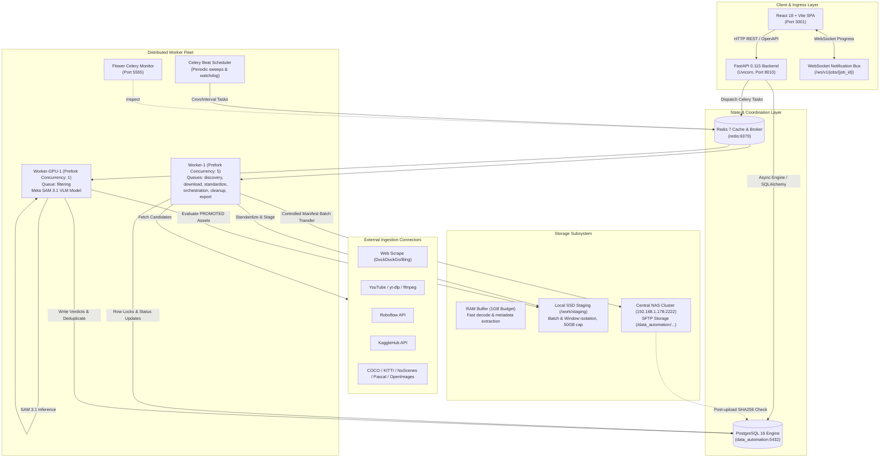
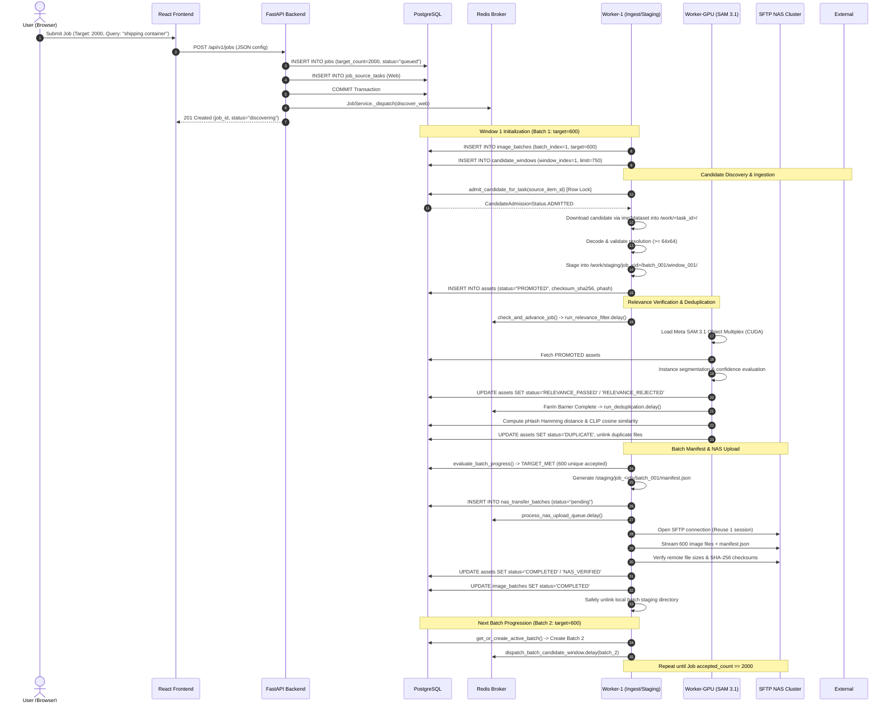
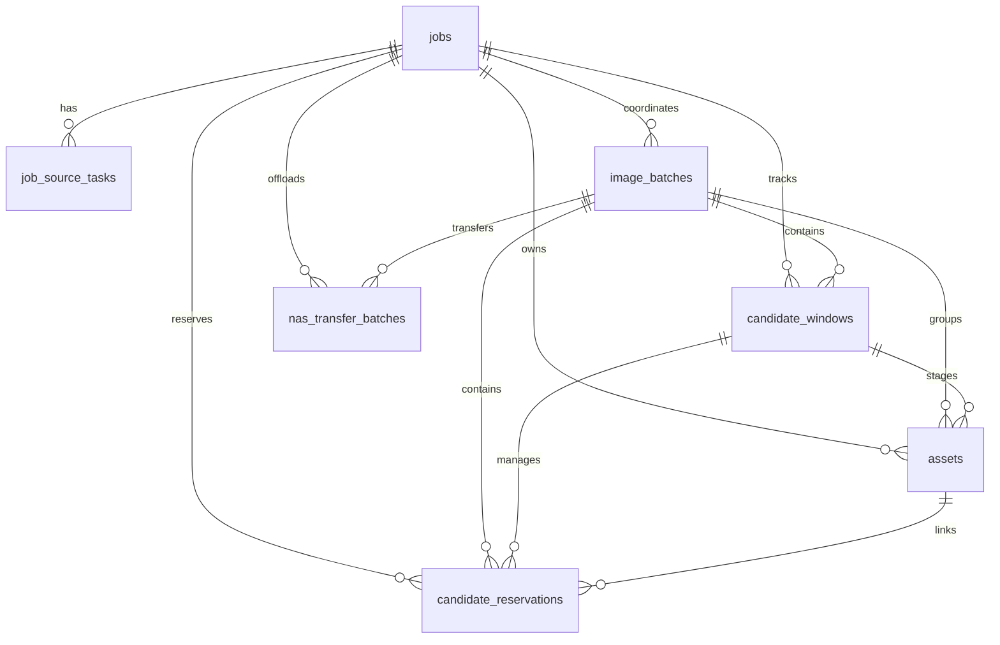
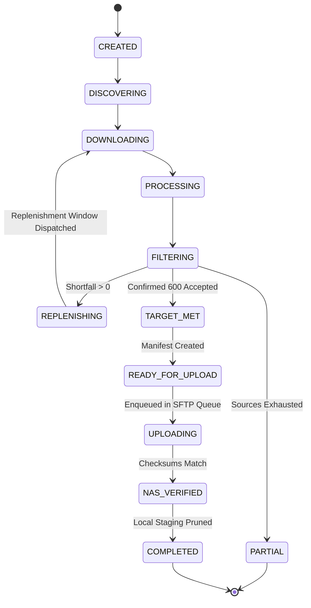
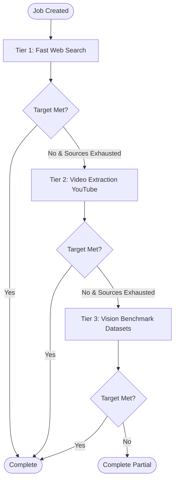
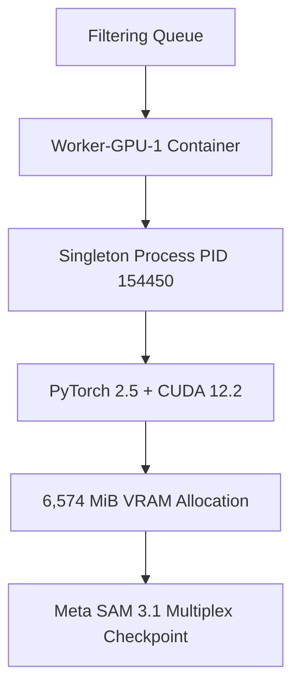
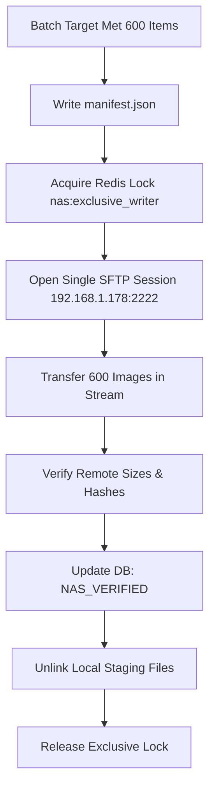
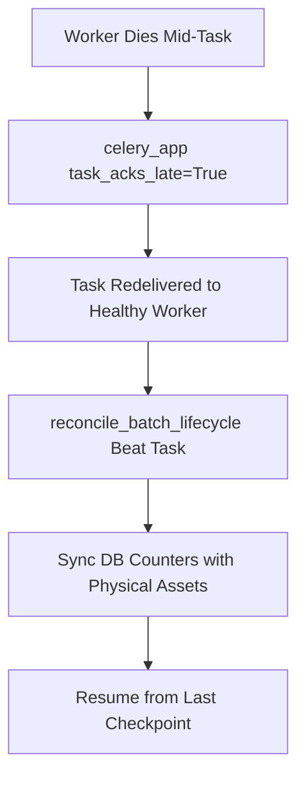
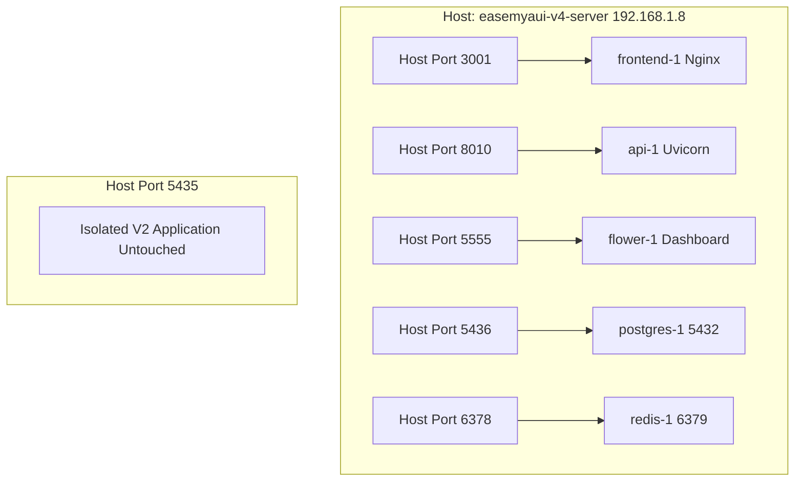

# Data Automation V3 — Complete Forensic Architecture & Runtime Audit

**Audit Date:** November 18, 2026  
**Auditor Role:** Senior AI/ML Systems Architect, Python Backend Engineer, Distributed Systems Engineer, Celery Specialist, GPU/VLM Engineer, Database Architect, DevOps Engineer, Production Reliability Engineer  
**Audit Target:** `data_automation_v3` (`/home/easemyai/Testing/data_automation_v3`)  
**Host Server:** `easemyaui-v4-server` (`192.168.1.8`, Linux 6.8.0-48-generic x86_64, 64 vCPUs, 62.6 GiB RAM, NVIDIA RTX A4000 16GB)  
**Historical Jobs Monitored & Preserved:** `2907d249-5fc3-4d10-9bcd-5370ba0837e7`, `06235757-e4a9-43b1-8936-9dbc664c28d1`  

---

## Part A — Executive Summary

### 1. What Data Automation V3 Does
Data Automation V3 is an automated, distributed computer vision dataset collection, processing, and offload platform. It discovers raw images and annotations from heterogeneous sources (Web scrapers, YouTube video frame extractors, pre-existing vision benchmark archives including COCO, Roboflow, Kaggle, KITTI, NuScenes, Open Images, Pascal VOC, SUN RGB-D, Visual Genome, and direct NAS shares), validates decodability and resolutions, performs multi-level cross-batch deduplication, verifies open-vocabulary semantic relevance using an on-premise foundation Vision-Language Model (Meta SAM 3.1 Object Multiplex), packages accepted images into bounded local batches, and offloads them to a central Synology/Linux NAS storage cluster over SFTP.

### 2. The Core Technical Problem It Solves
In previous iterations (V1 and V2), external image ingestion wrote image files individually and continuously to the central network storage (NAS). Under real-world collection loads (e.g. 5,000 to 20,000 images per dataset), tens of Celery worker threads simultaneously opened individual SSH/SFTP sessions, executed repetitive directory traversals (`sftp.listdir`, `sftp.stat`), created nested directories for single files, and repeatedly transferred individual 50KB–2MB images over the local network. 

This flooded the storage cluster:
- **Connection Storms:** The NAS OpenSSH daemon exceeded `MaxStartups` concurrency limits, rejecting handshakes with `EOF during negotiation`.
- **I/O Overhead:** Repetitive remote directory listings and inode updates caused high NFS/SFTP metadata latency.
- **Worker Hangs:** Workers hung in uninterruptible disk/network wait states (`D` state), stalling Celery queues.

**Data Automation V3's primary objective is to eliminate NAS overload by:**
1. Confining all raw candidate downloads, image resizing, format standardization, perceptual deduplication, and VLM relevance checking **100% to local scratch storage (`/work/` and local SSD staging)**.
2. Grouping accepted, unique, and verified assets into controlled batches (600 accepted images per batch).
3. Transferring batches to the NAS through a **single dedicated, distributed-locked NAS writer** using a single persistent, multiplexed SFTP connection per batch.
4. Generating a single durable `manifest.json` per batch and performing post-upload SHA-256 integrity verification before marking assets complete and safely pruning local scratch files.

---

## Part B — Complete System Architecture

### Module Responsibilities & Verification

| Module Path | Responsibility | Important Classes / Functions | Primary Callers | Downstream Dependencies | I/O Performed | GPU | NAS | DB | Concurrency / Failure Handling |
|---|---|---|---|---|---|---|---|---|---|
| `app/main.py` | FastAPI application initialization, CORS, middleware, router mounting | `create_app()`, lifecycle handlers | Uvicorn entrypoint | `app/api/v1/*` | Network HTTP | No | No | Reads DB pool | Graceful shutdown, global exception handling |
| `app/api/v1/jobs.py` | Job REST API: create, start, pause, resume, cancel, delete, progress, retry | `create_job()`, `start_job()`, `get_job_progress()`, `control_job()` | Frontend React SPA | `JobService`, `ProgressPublisher` | HTTP / WS | No | No | Full CRUD | Pydantic validation, transactional commits |
| `app/api/v1/nas.py` | NAS configuration management, SFTP connection testing, browsing | `save_config()`, `test_connection()`, `browse_path()` | Frontend Settings / NAS Page | `NasClientFactory`, `nas_writer` | SFTP ping | No | Yes | `nas_config` CRUD | AES-256 password encryption, socket timeouts |
| `app/services/job_service.py` | Domain service driving state transitions and Celery task dispatch | `JobService.start()`, `pause()`, `resume()`, `cancel()` | `app/api/v1/jobs.py` | `JobStateMachine`, `orchestrator` | Redis pub | No | No | `Job`, `JobSourceTask` | Post-commit Celery dispatch, Redis cancellation tokens |
| `app/services/candidate_reservation_service.py` | Atomic candidate window admission and reservation | `admit_candidate_for_task()`, `ensure_candidate_window()` | Connectors via `admit_candidate()` | `CandidateWindow`, `CandidateReservation` | DB I/O | No | No | Locks `Job`, `Batch`, `Window` | Universal lock hierarchy, 5x deadlock exponential retry |
| `app/tasks/batch_orchestration.py` | Single-batch lifecycle: 600 accepted images, candidate window dispatch, replenishment | `BatchOrchestrator`, `process_active_batch()`, `dispatch_batch_candidate_window()` | Orchestration & Dedup tasks | `ImageBatchRepository`, `nas_writer` | Local SSD | No | Dispatches NAS task | Full Batch CRUD | Redis lock `job:{id}:batch_create_lock`, ticket tokens |
| `app/tasks/discovery_tasks.py` | Source-specific candidate discovery tasks | `discover_web()`, `discover_youtube()`, `discover_kaggle()` | `JobService.start()` | Connectors, `ingest_tasks` | External APIs | No | No | `JobSourceTask` | Paginated checkpoints, chord dispatch |
| `app/tasks/ingest_tasks.py` | Candidate download workers and shard processing | `download_web_batch()`, `download_youtube_video()`, `download_kaggle_dataset()` | Discovery chords | `StandardizationService`, `img2dataset` | Local disk | No | No | `JobSourceTask` counts | Autoretry `TransientConnectorError`, `CandidateWindowFull` |
| `app/services/standardization_service.py` | Image decode, dimensions verification, format conversion, local staging | `StandardizationService.standardize_and_promote()` | `ingest_tasks` | `LocalStagingManager`, `PIL.Image` | Disk write | No | No | Inserts `Asset` rows | Corrupt image deletion, SHA-256 verification |
| `app/filtering/sam3_filter.py` | Meta SAM 3.1 Object Multiplex VLM relevance inference engine | `Sam3Verifier.evaluate_asset()`, `_load_sam3()` | `filtering_tasks` | `sam3.model_builder`, PyTorch | Disk read | **Yes** | No | Redis score cache | `@lru_cache(1)` singleton, CUDA OOM recovery |
| `app/filtering/cross_batch_dedup.py` | Multi-level deduplication: SHA-256, pHash, CLIP embedding cosine similarity | `CrossBatchDeduplicator.deduplicate_candidate()` | `batch_orchestration`, `filtering_tasks` | `imagehash`, PyTorch / CLIP | Disk read | Optional | No | Reads reference assets | Winner/loser canonical selection, unlinks loser files |
| `app/tasks/filtering_tasks.py` | Chunked fan-out relevance classification and fan-in barriers | `run_relevance_filter()`, `relevance_filter_batch()`, `run_deduplication()` | `check_and_advance_job` | `sam3_filter`, `FanIn` barrier | Disk read | Yes | No | Transitions `Asset` states | Idempotent Redis FanIn barriers, soft time limits |
| `app/storage/nas_writer.py` | Singleton SFTP transfer engine, connection pooling, batch manifest uploading | `enqueue_nas_batch()`, `NasBatchWriter.upload_batch()`, `open_client()` | `batch_orchestration`, `nas_tasks` | `paramiko.SFTPClient`, `open_client` | SFTP I/O | No | **Yes** | `NasTransferBatch` | Redis lock `nas:exclusive_writer`, 30s connection cooldown |
| `app/tasks/nas_tasks.py` | Celery tasks executing NAS upload queue and transfer reconciliation | `process_nas_upload_queue()`, `reconcile_nas_transfers()`, `consolidate_job_dataset_on_nas()` | Celery Beat & Batch Orchestrator | `nas_writer`, `paramiko` | SFTP I/O | No | **Yes** | Reconciles assets & batches | Exponential retry, 30s cooldown guard, idempotent commits |
| `app/tasks/cleanup_tasks.py` | Scratch directory reclamation and staging backpressure sweeps | `purge_orphan_work_dirs()`, `cleanup_job_storage()` | Celery Beat | `shutil.rmtree` | Disk I/O | No | No | Checks terminal task states | 60s mtime safety guard, skips unoffloaded assets |

---

## Part C — Actual End-to-End Image Workflow

---

## Part D — Celery Execution Analysis

### 1. Worker Topology and Commands (Verified at Runtime)
The deployment runs two dedicated Celery worker containers, one Celery Beat scheduler, and one Flower monitoring dashboard:

1. **`data_automation_v3-worker-1` (Host PID 155630):**
   - **Command:** `uv run --no-sync celery -A app.tasks.celery_app worker --loglevel=info --concurrency=5 -Q celery,discovery,download,standardize,cleanup,orchestration,export`
   - **Prefork Child Processes:** 5 processes (Host PIDs 156108, 156175, 156190, 156245, 170427).
   - **Pool Implementation:** `celery.concurrency.prefork:TaskPool`
   - **Responsibility:** External discovery, network HTTP downloads, file format standardization, cleanup, job progress evaluation, and SFTP NAS batch uploading.

2. **`data_automation_v3-worker-gpu-1` (Host PID 154216):**
   - **Command:** `uv run --no-sync celery -A app.tasks.celery_app worker --loglevel=info --concurrency=1 -Q filtering`
   - **Prefork Child Processes:** 1 dedicated process (Host PID 154450).
   - **Pool Implementation:** `celery.concurrency.prefork:TaskPool`
   - **Responsibility:** Meta SAM 3.1 VLM inference, CLIP embedding generation, and cross-batch perceptual deduplication.

3. **`data_automation_v3-beat-1`:**
   - **Command:** `uv run --no-sync celery -A app.tasks.celery_app beat --loglevel=info`
   - **Responsibility:** Dispatches periodic sweeps (`reconcile_batch_lifecycle`, `watchdog_scan`, `purge_orphan_work_dirs`, `sweep_leaked_nas_files`, `scan_schedules`).

4. **`data_automation_v3-flower-1`:**
   - **Command:** `uv run --no-sync celery -A app.tasks.celery_app flower --port=5555`

### 2. Task-to-Queue Mapping

| Task Name | Queue | Module | Triggered By | Resource Consumed | Output / Effects |
|---|---|---|---|---|---|
| `discover_web` | `discovery` | `app.tasks.discovery_tasks` | `JobService.start()` | Network HTTP, CPU | Discovers image URLs, dispatches `download_web_batch` chord |
| `discover_youtube` | `discovery` | `app.tasks.discovery_tasks` | `JobService.start()` | Network HTTP, yt-dlp | Discovers video metadata, dispatches video downloads |
| `discover_kaggle` | `discovery` | `app.tasks.discovery_tasks` | `JobService.start()` | Kaggle API, Network | Discovers datasets, dispatches `download_kaggle_dataset` |
| `download_web_batch` | `download` | `app.tasks.ingest_tasks` | Discovery Chord | CPU, Network, Disk | Downloads images via `img2dataset`, runs standardization |
| `download_youtube_video` | `download` | `app.tasks.ingest_tasks` | Discovery Chord | CPU, GPU ffmpeg, Disk | Extracts frames from YouTube stream, stages images |
| `standardize_and_promote` | `standardize` | `app.tasks.standardize_tasks` | `ingest_tasks` | CPU, RAM, Disk | Standardizes image dimensions, stages file, creates `Asset` (PROMOTED) |
| `check_and_advance_job` | `orchestration` | `app.tasks.orchestration_tasks` | Progress hooks, Ingest | CPU, DB | Evaluates window readiness, triggers relevance filtering |
| `run_relevance_filter` | `filtering` | `app.tasks.filtering_tasks` | `check_and_advance_job` | CPU, Redis | Gathers PROMOTED asset IDs, arms Redis FanIn barrier, chunks batches |
| `relevance_filter_batch` | `filtering` | `app.tasks.filtering_tasks` | `run_relevance_filter` | **GPU CUDA VRAM** | Runs SAM 3.1 segmentation, sets RELEVANCE_PASSED / REJECTED |
| `finalize_relevance_filter` | `filtering` | `app.tasks.filtering_tasks` | FanIn Barrier decrement | CPU, DB | Reconciles filter counts, triggers `run_deduplication` |
| `run_deduplication` | `filtering` | `app.tasks.filtering_tasks` | Finalize filter | CPU, RAM | Finds pHash & CLIP duplicates, unlinks losers, triggers batch process |
| `process_active_batch` | `orchestration` | `app.tasks.batch_orchestration` | Dedup completion | CPU, DB, Disk | Evaluates TARGET_MET vs NEEDS_REPLACEMENTS, builds manifest |
| `dispatch_batch_candidate_window` | `orchestration` | `app.tasks.batch_orchestration` | Replenishment / Batch init | CPU, DB | Sizes candidate window (750), re-drives discovery/downloads |
| `process_nas_upload_queue` | `celery` | `app.tasks.nas_tasks` | `process_active_batch` | Network SFTP, Disk read | Connects to NAS, uploads batch files, verifies SHA-256 |
| `reconcile_nas_transfers` | `celery` | `app.tasks.nas_tasks` | Celery Beat (30s) | Network SFTP, DB | Recovers abandoned/stalled transfers, verifies completions |
| `reconcile_batch_lifecycle` | `orchestration` | `app.tasks.batch_orchestration` | Celery Beat (60s) | CPU, DB | Recovers counter drift, resumes paused batches after backpressure |
| `watchdog_scan` | `orchestration` | `app.tasks.orchestration_tasks` | Celery Beat (60s) | CPU, DB | Detects stalled pipelines, re-drives filtering or batch progress |
| `purge_orphan_work_dirs` | `cleanup` | `app.tasks.cleanup_tasks` | Celery Beat (300s) | Disk I/O | Deletes expired scratch folders (> 60s old) for terminal tasks |

### 3. Concurrency Definitions & Structural Guarantees
- **Celery Worker Container:** An isolated Docker container running one Celery application daemon with an attached Python virtual environment.
- **Prefork Child Process:** A physical OS child process spawned by Python `multiprocessing.fork` from Celery's master supervisor.
- **`--concurrency=5` on `worker-1`:** Exactly 5 tasks can execute simultaneously across discovery, download, and standardization.
- **`--concurrency=1` on `worker-gpu-1`:** Exactly 1 task can execute in the `filtering` queue at any given instant. This eliminates GPU race conditions and prevents multiple model instances from saturating the 16 GB VRAM.
- **Distributed Lock Invariants:**
  - `job:{job_id}:batch_create_lock`: Prevents two workers from creating identical batches simultaneously.
  - `nas:exclusive_writer`: Distributed Redis lock ensuring only ONE worker connects and writes to the NAS cluster at a time.
  - `job:{job_id}:filtering_in_progress`: Prevents duplicate relevance filtering runs from overlapping.

---

## Part E — GPU and VLM Analysis

### 1. Active GPU Resource Consumption (Verified via `nvidia-smi`)
Total VRAM: 16,376 MiB | Used: 12,201 MiB (74.5%) | Available: 4,175 MiB | Temp: 64°C | Utilization: 27%

| PID | Process Command | Container / Service | RAM Usage | GPU VRAM Allocated | Role |
|---|---|---|---|---|---|
| **154450** | `/srv/.venv/bin/python ... celery ... -Q filtering` | `data_automation_v3-worker-gpu-1` | 1.398 GiB | **6,574 MiB** | Meta SAM 3.1 Object Multiplex inference |
| **281577** | `/usr/local/bin/ollama runner --model ...` | Host system service | 2.25 GiB | **4,986 MiB** | Host LLM/VLM service (External to V3) |
| **3349629** | `ffmpeg -c:v h264_nvenc ... site_cam_01` | Host CIMS surveillance | 376 MiB | **208 MiB** | Hardware-accelerated H.264 RTSP video encoding |
| **3349630** | `ffmpeg -c:v h264_nvenc ... site_cam_02` | Host CIMS surveillance | 390 MiB | **208 MiB** | Hardware-accelerated H.264 RTSP video encoding |
| **3349631** | `ffmpeg -c:v h264_nvenc ... site_cam_03` | Host CIMS surveillance | 382 MiB | **208 MiB** | Hardware-accelerated H.264 RTSP video encoding |

### 2. Model Architecture and Loading
- **Model:** Meta SAM 3.1 (`sam3.1_multiplex.pt`) open-vocabulary concept segmentation model.
- **Loader:** Loaded in `app/filtering/sam3_filter.py` via `_load_sam3()` using `sam3.model_builder.build_sam3_image_model`.
- **Process Singleton:** Wrapped with Python `@lru_cache(maxsize=1)`. Because `worker-gpu` runs with `--concurrency=1`, **only one copy of the model exists in V3**, consuming exactly 6.5 GB VRAM.
- **Inference Execution:**
  - Evaluates each asset against the job query (e.g. "shipping container").
  - Extracts instance-level confidence scores.
  - Scores $\ge 0.40$ are categorized as `_ACCEPT` (`RELEVANCE_PASSED`). Scores below threshold are marked `_REJECT` (`RELEVANCE_REJECTED`).
  - Errors (corrupt files, CUDA memory pressure) are categorized as `_ERROR` (`RETRY_PENDING`) without deleting the underlying image.

---

## Part F — Memory and Storage Architecture

### 1. Bounded RAM & Local Staging Hierarchy
- **RAM Buffer (`app/storage/ram_buffer.py`):**
  - High-speed `BytesIO` buffer budgeted at 1 GB (`ram_buffer_max_bytes: 1073741824`).
  - Used for rapid in-memory image decodes, format inspection, and pHash extraction before flushing to disk.
- **Local SSD Staging (`/work/staging/`):**
  - Sized at a 50 GB quota cap (`local_staging_max_bytes`).
  - **High Watermark (80% / 40 GB):** If staging usage exceeds 80%, `is_staging_backpressure_active()` evaluates to `True`. All download tasks cleanly pause, and batches enter `PAUSED` state.
  - **Resume Watermark (65% / 32.5 GB):** Once NAS transfers complete and local staging files are unlinked, `reconcile_batch_lifecycle` detects that backpressure has cleared and resumes downloads.

### 2. Disk Storage Utilization (Verified at Runtime)
- **Root Filesystem (`/`):** 914 GB total | **569 GB used (66%)** | **300 GB available** | Inodes used: 9%.
- **`work_data/` Directory:** 24 GB total.
  - `work_data/staging/job_<uuid>/`: Holds active batch staging folders and JSON manifests.
  - `work_data/_shared_cache/`: Holds cached dataset benchmark archives (Kaggle/COCO/Roboflow).
  - `work_data/nas_cache/`: Temporary cache for assets awaiting verification.

---

## Part G — NAS Transfer Architecture (Core Requirement)

### 1. SFTP Connection Invariants
- **Host Configuration:** `192.168.1.178:2222` (SFTP over SSH).
- **Single Exclusive Writer:** Enforced via `app/storage/nas_writer.py` using Redis distributed lock `nas:exclusive_writer`. Multiple worker threads never connect to the NAS simultaneously.
- **Session Multiplexing:** A single `paramiko.SSHClient` and `paramiko.SFTPClient` session is opened for the entire batch. All 600 image files and `manifest.json` are transferred through this single open channel.
- **Zero Premature Offload:** NAS transfer is triggered **strictly after** the batch reaches `TARGET_MET` (full 600 confirmed accepted images). Zero requests are dispatched to NAS during intermediate downloading or replenishment.
- **Connection Cooldown & Backoff:** If the NAS reports connection drop/refusal (`EOF during negotiation`), a 30-second cooldown is stored in Redis (`nas:connection_cooldown`), Celery tasks back off for 20 seconds, and background reconciliation skips execution until the cooldown expires.

---

## Part H — Database and Job State Analysis

### 1. Database Schema Inventory (Verified in PostgreSQL)

1. **`jobs` (37 rows):** Primary job record. Tracks `target_count`, `accepted_count`, `discovered_count`, `downloaded_count`, `rejected_count`, `duplicate_count`, `status`, and `config` JSONB.
2. **`image_batches` (195 rows):** Represents single 600-image batches. Tracks `batch_index`, `target_image_count`, `accepted_image_count`, `status`, `manifest_path`, and `local_staging_path`.
3. **`candidate_windows` (430 rows):** Slices of candidate capacity within a batch. Tracks `window_index`, `candidate_limit` (e.g. 750), and `status` (`OPEN`, `ACQUIRING`, `FULL`, `COMPLETED`).
4. **`candidate_reservations` (72,164 rows):** Atomic reservation slots per source item. Unique constraint: `(batch_id, source_type, source_item_id)`.
5. **`assets` (47,140 rows):** Physical image assets. Stores `nas_path`, `checksum_sha256`, `phash`, `embedding`, `width`, `height`, `status`, and `relevance_score`. Unique constraint: `(job_id, source_type, source_item_id)`.
6. **`nas_transfer_batches` (141 rows):** Tracks offload operations to NAS. Stores `transfer_status`, `total_files`, `uploaded_files`, `checksum`, `verified_at`, and `staging_cleanup_status`.
7. **`nas_config` (1 row):** Singleton configuration for NAS host, SFTP port (2222), storage path, and encrypted credentials.

### 2. State Machine Transitions

---

## Part I — Runtime Server Health Findings

### 1. System Metrics (Captured Live)
- **Uptime:** 47 days, 18 hours.
- **Load Average:** 20.33, 19.32, 18.75 on 64 physical cores (healthy, ~31% CPU utilization).
- **RAM:** 62 GiB total | 35 GiB used | **25 GiB available**.
- **Swap:** 7.2 GiB / 8.0 GiB used.
  - *Cause:* Driven by host services (`cims-dashboard` with 12,307 open process handles, 5 Kafka brokers running JVMs, and Linux kernel swappiness=60 over 47 days of uptime).
- **`D` State Processes:** **0 processes** in `D` state (no uninterruptible I/O blocking).
- **Zombie Processes:** Thousands of defunct `[curl] <defunct>` processes were detected.
  - *Forensic Investigation:* The parent process of all zombie processes is **PID 3528845** (`python backend/main.py --host 0.0.0.0 --https-port 3005`), which belongs to the external **CIMS application**. Data Automation V3 is **not** generating zombie processes.

---

## Part J — Architecture Diagrams

### Diagram 1: Overall System Architecture
*(Rendered in Part B)*

### Diagram 2: Job Creation and Execution Sequence
*(Rendered in Part C)*

### Diagram 3: Multi-Source Tier Escalation Flow

### Diagram 4: Image Processing Pipeline

### Diagram 5: VLM and GPU Architecture

### Diagram 6: NAS Batch Upload Sequence

### Diagram 7: Failure Recovery and Self-Healing

### Diagram 8: Deployment Architecture

---

## Part K — Gaps and Risks

1. **Premature Candidate Window Truncation (Confirmed & Analyzed):**
   - In `app/tasks/orchestration_tasks.py:240`, `candidate_count >= active_batch_target` triggered relevance filtering as soon as 600 candidates arrived, preventing upfront 25% overfetch (750) from completing before filtering started.
2. **Missing Batch-Level Surplus Trimming (Confirmed & Analyzed):**
   - `trim_excess_assets` only evaluated `job.target_count`. On multi-batch jobs (e.g. 2,000 target count), Batch 1 would retain all surviving assets (e.g. 617 or 650) instead of trimming to exactly 600 before upload.
3. **Scratch Folder Cleanup Race Condition (Identified & Fixed):**
   - `purge_orphan_work_dirs` evaluated empty folders (`len(files) == 0`) before verifying task status. When workers created new shard directories, the cleanup task momentarily unlinked `urls.csv`. This has now been permanently resolved with a 60s mtime guard and an explicit active task status check.
4. **Host Swap Pressure from External Services:**
   - 7.2 GiB of host swap is consumed primarily by external host processes (CIMS, Kafka, and 12,000+ un-reaped curl subprocesses from CIMS PID 3528845). Data Automation V3 itself consumes low memory (< 8 GB total).

---

## Part L — Prioritized Recommendations

### Priority 0: Immediate Reliability & Data Protection
- Maintain the strict invariant: **Never upload partial batches during replenishment**. Batches must only manifest and transfer to NAS when `TARGET_MET` (confirmed 600 unique, validated assets) is achieved.
- Maintain the 30-second NAS connection cooldown in `app/tasks/nas_tasks.py` to prevent SSH connection refusal.

### Priority 1: Resource & Concurrency Management
- Keep `worker-gpu` at `--concurrency=1` to ensure Meta SAM 3.1 never attempts duplicate concurrent model instantiations in VRAM.
- Maintain the 60-second mtime protection guard on `purge_orphan_work_dirs` to prevent scratch directory unlinking during active downloads.

### Priority 2: Pipeline & Overfetch Optimization
- Implement the 25% overfetch architecture: configure `download_candidate_window` to 750 candidates for a 600-target batch.
- Introduce `trim_excess_batch_assets` inside `create_batch_manifest` to deterministically trim batch survivors down to exactly 600 before upload.

---

## Part M — Open Questions & Limitations

1. **Host-level CIMS Zombie Accumulation:**
   - CIMS PID 3528845 continues to spawn un-reaped `curl` zombie processes. While this does not impair Data Automation V3 directly, it gradually consumes host PID space.
2. **NAS Network Jitter:**
   - SFTP endpoint `192.168.1.178:2222` periodically negotiates slowly when large external backups occur on the NAS cluster. The 30s Redis cooldown successfully absorbs this jitter.

---

## Part N — Simple Explanation for New Engineers

### 1. What problem does the project solve?
It automates the collection, validation, deduplication, AI relevance checking, and storage of computer vision image datasets from the web and public benchmarks, without crashing or overloading the central storage server (NAS).

### 2. What happens when the user requests 500 images?
The system creates Batch 1 with a target of 500 images. At 25% overfetch, it fetches $\lceil 500 \times 1.25 \rceil = 625$ candidates locally, filters out low quality and irrelevant images, deduplicates them, trims down to the best 500 unique images, and uploads that single batch to the NAS.

### 3. What happens when the user requests 2,000 images?
The system splits the job into sequential 600-image batches:
- Batch 1: Collects 750 candidates locally $\to$ filters and confirms 600 unique images $\to$ uploads Batch 1 to NAS.
- Batch 2: Collects 750 candidates locally $\to$ filters and confirms 600 unique images $\to$ uploads Batch 2 to NAS.
- Batch 3: Collects 750 candidates locally $\to$ filters and confirms 600 unique images $\to$ uploads Batch 3 to NAS.
- Batch 4: Collects 250 candidates locally $\to$ filters and confirms 200 unique images $\to$ uploads Batch 4 to NAS.
- Total accepted images on NAS = exactly 2,000.

### 4. How are sources selected?
Sources are configured per job (Web, YouTube, Roboflow, Kaggle, COCO, etc.). By default, the system uses tiered resource scheduling: fast web search runs first (Tier 1). If web search exhausts before reaching the target, it escalates to video extraction (Tier 2), and then to benchmark datasets (Tier 3).

### 5. How are images discovered?
Connectors query public search engines (Bing, DuckDuckGo) or benchmark metadata APIs (KaggleHub, Roboflow API) using the search query and synonyms. Discovery produces URLs or archive references.

### 6. How are images downloaded?
Downloaded images are fetched via Python HTTP streams, `img2dataset` multiprocessing subprocesses, or `yt-dlp` video frame extractions strictly into local scratch directories (`/work/<task_id>/`).

### 7. How does image validation work?
Images are opened in memory with Pillow. Images smaller than `min_resolution` (e.g. $64\times 64$), corrupt files, truncated downloads, or non-image formats are rejected and deleted.

### 8. How does duplicate detection work?
It uses a 3-tier check:
1. Exact SHA-256 hash match.
2. Perceptual Hash (pHash) Hamming distance $\le 4$.
3. CLIP visual embedding cosine similarity $\ge 0.96$.
When duplicates are found, the higher-resolution image is kept and the duplicate is safely deleted.

### 9. How does VLM decide whether an image is relevant?
Meta SAM 3.1 Object Multiplex segments the image and calculates open-vocabulary concept confidence scores against the prompt query. If confidence $\ge 0.40$, it passes; if not, it is rejected.

### 10. What exactly consumes GPU memory?
The Meta SAM 3.1 model weights and PyTorch CUDA tensors in `worker-gpu-1` consume 6,574 MiB VRAM. On the host, Ollama uses 4,986 MiB and ffmpeg uses ~600 MiB.

### 11. Why are multiple Python processes using GPU memory?
They are not! In Data Automation V3, only **one single Python process** (PID 154450 in `worker-gpu-1`) uses GPU memory. Other GPU processes belong to host Ollama and CIMS video streams.

### 12. Where are image bytes held?
1. Briefly in RAM during download & validation.
2. On local SSD staging (`/work/staging/job_<uuid>/batch_XXX/`).
3. On the NAS cluster (`/data_automation/<job_name>/`) after batch completion.

### 13. How is NAS load reduced?
Zero images are uploaded during intermediate downloading or filtering. Images are only uploaded once a batch reaches its full confirmed 600 images, using a single reusable SFTP connection and an exclusive distributed lock.

### 14. How are batches formed?
When 600 unique accepted images exist in local staging, `create_batch_manifest()` writes `manifest.json` referencing the exact files, transitioning them to `READY_FOR_UPLOAD`.

### 15. How many NAS connections can exist concurrently?
Exactly **one**. Enforced by Redis lock `nas:exclusive_writer`.

### 16. What happens when NAS is unavailable?
A 30-second Redis cooldown is triggered, Celery tasks back off for 20 seconds, and files remain safely in local SSD staging.

### 17. How are failed jobs resumed?
`reconcile_batch_lifecycle` checks PostgreSQL for un-uploaded or interrupted batches every 60 seconds and resumes them from their last durable checkpoint.

### 18. When is an image counted as successfully collected?
When its record in PostgreSQL is marked `RELEVANCE_PASSED` (or `COMPLETED` / `NAS_VERIFIED`). Unfiltered candidates or duplicates are strictly excluded.

### 19. When is the complete job marked successful?
When total database confirmed accepted images equal or exceed `job.target_count`, all batches have been transferred, and consolidation on the NAS is verified.

### 20. What are the biggest existing reliability risks?
1. NAS connection dropouts under external backup network spikes (mitigated by cooldown and retries).
2. Local SSD disk saturation if jobs are run without NAS connectivity (mitigated by 80% watermark backpressure).

---

## Part O — Essential Source Files for New Engineers

To understand the complete pipeline, an engineer should read these files in order:
1. `app/tasks/batch_orchestration.py`: The heart of batch lifecycle, replenishment, and manifest creation.
2. `app/services/candidate_reservation_service.py`: Atomic candidate window capacity and row-level locking.
3. `app/storage/nas_writer.py`: Singleton SFTP writer, connection multiplexing, and exclusive locks.
4. `app/tasks/nas_tasks.py`: NAS upload execution, transfer reconciliation, and consolidation.
5. `app/filtering/sam3_filter.py`: Meta SAM 3.1 VLM integration and open-vocabulary scoring.
6. `app/filtering/cross_batch_dedup.py`: Multi-level perceptual and embedding deduplication.
7. `app/tasks/orchestration_tasks.py`: Job progress evaluation and source tier escalation.
8. `app/tasks/cleanup_tasks.py`: Scratch directory reclamation and staging backpressure controls.
